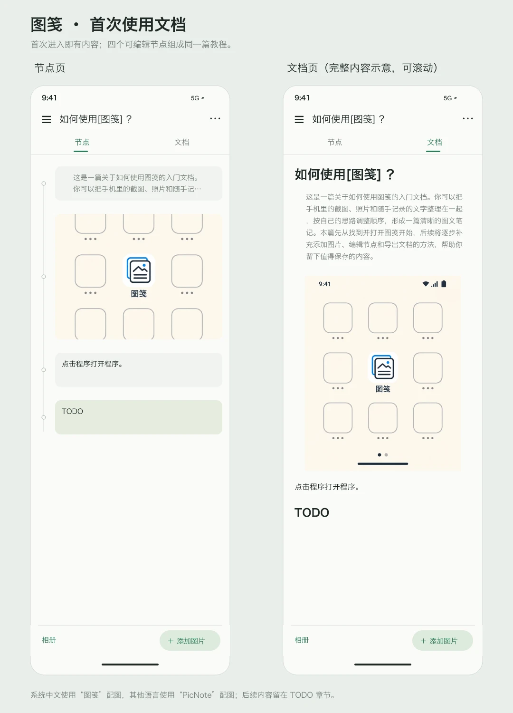

# 竹节笔记 / Bambootes · 04 首次使用文档

首次进入应用直接打开内置教程，用户可以在节点页编辑，也可以切换到文档页阅读。教程是普通本地文档，支持标题节点编辑、排序、删除与 Markdown / ZIP 导出。

## 文档内容

简体中文标题为“如何使用[竹节笔记] ？”，引言如下：

> 这是一篇关于如何使用竹节笔记的入门文档。你可以把手机里的截图、照片和随手记录的文字整理在一起，按自己的思路调整顺序，形成一篇清晰的图文笔记。本篇先从找到并打开竹节笔记开始，后续将逐步补充添加图片、编辑节点和导出文档的方法，帮助你留下值得保存的内容。

引言之后依次是手机桌面图、独立文字节点“点击程序打开程序。”和仅包含标题的 `TODO` 章节。后续使用步骤补充在该章节之后。

| 顺序 | 节点类型 | 内容 |
| --- | --- | --- |
| 1 | `title` | 如何使用[竹节笔记] ？ |
| 2 | `introduction` | 教程引言 |
| 3 | `body` | 三列三行手机桌面图 |
| 4 | `body` | 点击程序打开程序。 |
| 5 | `chapter` | TODO |

独立教程：简体中文 [document.md](src/main/assets/welcome/zh-CN/document.md)、英文 [document.md](src/main/assets/welcome/en/document.md)。两个文件可以脱离应用阅读，图片使用相对路径。

## 手机桌面图

正式图标采用纯白背景的绿色竹节笔，中英文桌面图使用相同标志，资源说明见 [README.md](artwork/bambootes/README.md)。

使用内置 `image_gen.imagegen` 编辑，分别以对应语言的桌面图为编辑目标、[01-bamboo-pen.png](artwork/bambootes/01-bamboo-pen.png) 为图标参考。保留三列三行、米白桌面和其余八个空心占位图标，只替换正中间的白底竹节笔图标及名称。中文名称为“竹节笔记”，英文名称为“Bambootes”。

| 系统语言 | 教程与桌面图 | 资源目录 |
| --- | --- | --- |
| 中文 `zh` | 简体中文 | `assets/welcome/zh-CN/` |
| 其他语言 | 英文 | `assets/welcome/en/` |

每个目录包含 `document.json`、`document.md` 和 `launcher.webp`。`document.json` 保存运行时内容、图片宽高与 SHA-256；`document.md` 是独立阅读副本。图片均为 512 × 640，由 `~/bin/pastehub-image` 按质量 90 编码为有损 WebP，随包保存，不在运行时请求图片生成服务。

完整生成提示词见 [教程配图提示词.md](原型图/教程配图提示词.md)。

## 初始化与本地保存

`PicNoteViewModel` 在首页首次加载时先调用 `DocumentRepository.initializeWelcome()`，再清理素材和加载文档。初始化复用 Repository 的 Mutex 与 Room 事务，在 IO 线程复制所选语言的图片，然后一次性提交文档、五个节点和图片引用。

初始化完成后保存 `welcome_initialized` 与最近文档标记，并使用现有 Markdown 镜像流程生成 `doc.md`。既有安装已有文档时只记录初始化已处理，不插入教程；教程被用户删除后不再重建。语言仅在初始化时决定，之后改变系统语言不覆盖或重新生成用户文档。

图片保存在 `filesDir/documents/welcome/media/launcher.webp`，复制不需要相册权限，也不依赖压缩 AAR。普通导入图片仍使用原有 WebP 流程。初始化失败由首页现有错误机制提示，未提交素材会清理，后续启动可重新尝试；镜像失败沿用既有重试入口。

教程通过固定 `WelcomeDocumentId` 识别，节点页和文档页均隐藏右下相册浮动按钮、左下新增图片提示与待选纸带；修改标题或切换语言不改变此行为。

## 文档入口

抽屉始终显示“我的文档”与“＋ 新建”。点击“＋ 新建”打开独立的“新建文档”页面，包含必填的标题与可选引言，左侧为返回箭头，右侧为“创建”。标题去除首尾空白后不能为空；点击“创建”且保存成功后才生成文档。固定创建第一个 `title` 节点与第二个 `introduction` 节点，引言留空时保留空主引言；返回或取消不创建文档。

首次进入直接展示教程，不显示“空空如也”页面。用户主动删除全部文档后，首页正文留空，仍可从抽屉新建；此时从素材入口添加内容也先完成创建页面，再继续选图或导入。所有节点使用独立全屏编辑页，左侧为返回箭头，保留未保存修改的退出确认。固定头部、链尾插入项与合并规则见 [05-节点设计.md](05-节点设计.md)。

## 原型图

原型同时展示节点页与完整文档内容，文档页实际可滚动。生成脚本为 [generate-welcome-prototype.mjs](原型图/generate-welcome-prototype.mjs)，直接读取随包中文教程与配图，通过 `~/bin/pastehub-image` 输出质量 90 的 WebP。
