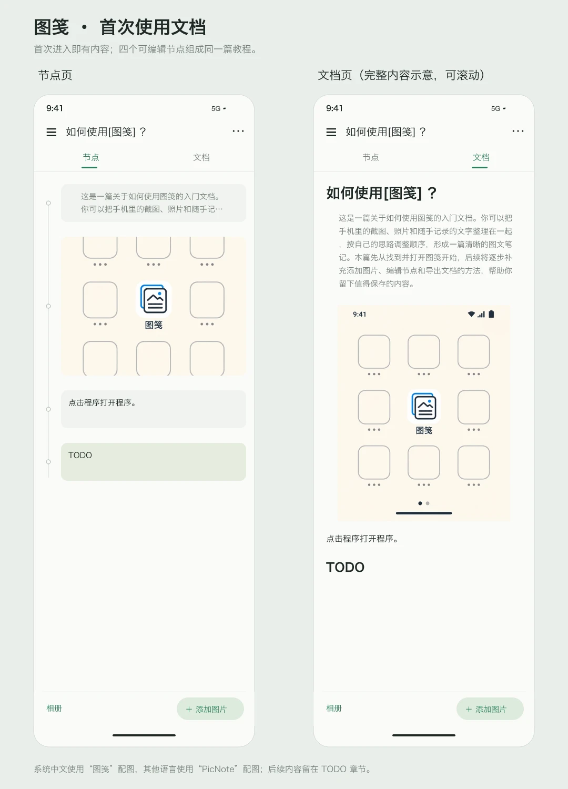

# 竹节笔记 / Bambootes

中文名称为“竹节笔记”，英文名称为“Bambootes”。正式图标采用纯白背景的竹节笔，资源说明见 [README.md](artwork/bambootes/README.md)。

本地图片与 Markdown 文档工具。用户收集截图、添加文字并调整节点顺序，文档页直接展示这些素材组成的图文笔记。

仅支持 Android 12（API 31）及以上，采用 Compose 单 `MainActivity : AppCompatActivity` + Navigation 3。手动选图使用无需图片库权限的 Photo Picker；用户另行授予完整图片权限后，每次进入前台比较仅含 URI 与加入时间的快照，提取最新新增图片。授权用途弹窗仅主动提示一次，之后从首页图片权限旁的小箭头进入；不实现悬浮窗或后台截图监听。选图后通过 PasteHub AAR 转为质量常量 90 的 WebP，保存到私有 files 目录并持久化源 URI 映射。

完整图片权限下，待选面板“添加”左侧提供模式入口；三种模式为只添加、添加后删除原图、添加并删除本批全部，选择后立即持久化。第 3 种每次添加前确认整批范围；选中图片完成本地保存后才请求系统删除。手动 Photo Picker 继续只添加图片。具体规则见 [03-程序界面设计.md](03-程序界面设计.md)。

当前已实现主界面为 `节点 / 文档` 两个 Tab；解析升级设计为 `节点 / 文档 / 会话` 三个 Tab，其中“会话”展示 LLM 的 SSE 实时输出与历史轮次。内容由用户维护，Markdown 由本地规则组织；当前已实现版本尚未接入大模型、解析轮次或记忆系统；升级方案见下方 `doc` 索引。

首次进入直接打开“如何使用[竹节笔记] ？”教程，根据系统语言选择中文或英文内容和三列三行的小尺寸桌面配图。“＋新建”打开独立页面，填写必填标题与可选引言，点击“创建”成功后才生成文档；返回或取消不创建。节点分为标题、引言、章节标题和正文，前两位固定，链尾始终保留一个插入入口。节点圆点下方单独显示两位起步编号，卡片使用主题类型色；右上角仅显示渐显渐隐的带框笔形编辑图标，点击图标进入独立全屏编辑页；菜单只向前插入，正文拖动用于确认合并。

与 agit 共用 Black、White、Dracula、Sage、Alucard 颜色方案及按钮样式，默认 Sage，可从文档抽屉底部切换并保存；外观单选按钮与主题名称间距为 8dp。Alucard 参考 Notepadmm 的同名浅色主题。抽屉始终显示“我的文档”和“＋新建”；教程只初始化一次，删除后不自动补回。

`PicNoteApplication` 继承 `CommonInitApplication`，接入公共初始化、日志、异常处理和前后台通知。业务导航保持单 `MainActivity : AppCompatActivity` + Navigation 3；图片选择复用公共模块提供的纯 Compose 入口，不依赖 Fragment。

图片检查仅由应用进入前台触发，顶栏不提供刷新入口。公共日志按 `startupId` 和 `foreground_enter` 序号记录进入次数，窗口焦点与多窗口回调另行记录，便于核对窗口模式。引言以灰字显示，节点卡文字 padding 统一见 [05-节点设计.md](05-节点设计.md) 的“节点文字 padding”表；Markdown 导出为 `>` 引用。

| 文档 | 内容 |
| --- | --- |
| [01-总体思路.md](01-总体思路.md) | 产品定位、对象与核心流程 |
| [02-文档与本地存储.md](02-文档与本地存储.md) | 节点到 Markdown 的映射、保存与导出 |
| [03-程序界面设计.md](03-程序界面设计.md) | 两个 Tab、节点图片与备注编辑、Markdown 阅读预览 |
| [04-首次使用文档.md](04-首次使用文档.md) | 内置教程、中英文配图与首次初始化 |
| [05-节点设计.md](05-节点设计.md) | 节点类型、独立编辑页、插入、移动、合并与主题配色 |
| [doc/README.md](doc/README.md) | 解析升级设计（尚未实现）：范围、轮次、记忆、界面、迁移及三张原型 |
| [原型图/README.md](原型图/README.md) | 原型索引与生成方法 |

初版范围以五份文档为准；原型中的归档、设置等未纳入入口不实现。截图解析升级的设计结论见 [doc/README.md](doc/README.md)，当前代码尚未接入网络与解析能力。

应用模块为 `:picnote`，应用 ID 为 `com.allan.picnote`，从仓库根工程打开。入口为 [MainActivity.kt](src/main/java/com/allan/picnote/MainActivity.kt) 与 [PicNoteApp.kt](src/main/java/com/allan/picnote/ui/PicNoteApp.kt)；文档保存见 [DocumentRepository.kt](src/main/java/com/allan/picnote/data/repositories/DocumentRepository.kt)，图片差异检查见 [MediaScanner.kt](src/main/java/com/allan/picnote/media/MediaScanner.kt)。
