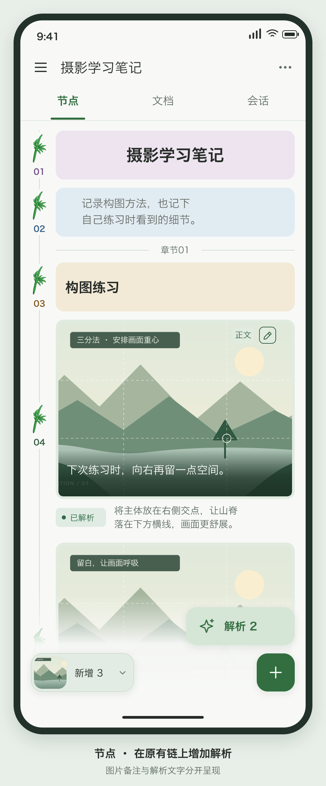
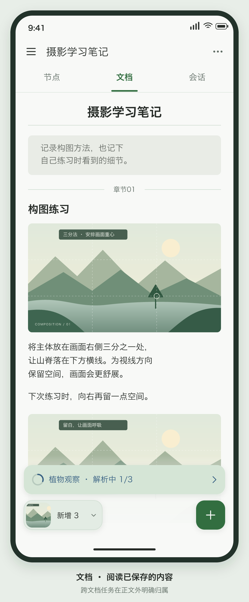
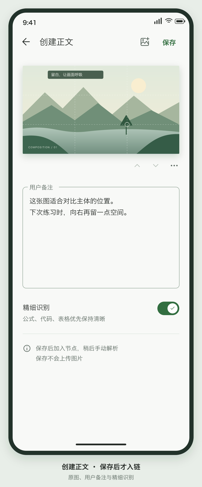

# 竹节笔记 / Bambootes · 解析升级设计

本组文档描述 PicNote 的“截图解析”升级：在现有节点链之上增加一层图片转文字能力，模型逐节点产出笔记文字，用户在节点页校对，文档页与导出仍由本地规则按链序生成。

基线是 `PicNote` 现有五篇文档与 `src/main` 代码。本组只写升级部分；节点类型、文档抽屉、主题、教程和图片检查等未改动能力沿用基线；解析相关行为以本组为准，入口继承与数据结构以实际代码核对。

`src/main` 目前没有任何网络与解析代码，本组是升级实现前的设计结论。

| 文档 | 内容 |
| --- | --- |
| [01-升级范围与总体思路.md](01-升级范围与总体思路.md) | 定位、沿用与不纳入清单、对象、数据流、边界 |
| [02-节点解析与轮次.md](02-节点解析与轮次.md) | 解析状态、批次打包、NDJSON 协议、事务提交、取消与恢复 |
| [03-上下文与记忆.md](03-上下文与记忆.md) | 起始信息、章节索引、节点摘要、分段记忆、预算与失效 |
| [04-界面升级.md](04-界面升级.md) | 三个 Tab、独立新增节点、提交入口、解析遮罩、会话 SSE 记录、记忆与偏好页 |
| [05-存储、配置与迁移.md](05-存储、配置与迁移.md) | Room v4、v1/v2/v3 升级路径、配置、逐图缓存与留档边界 |
| [README.md](原型图/README.md) | 节点/文档 Tab 与新增正文节点三张原型、生成脚本；会话 Tab 交互见 04 |

## 升级一句话

```text
截图进入节点链（现有流程）→ 提交待解析节点 → NDJSON 流式返回 → 逐节点本地提交
  → 节点页显示“已解析”文字 → 文档页与导出按链序重新生成 → 轮次、SSE 记录与分段记忆留档
```

模型只产出节点文字与摘要标签，不创建、不移动、不删除节点与章节；文档结构仍由用户决定。

| 类别 | 内容 |
| --- | --- |
| 沿用 | 节点链为唯一编辑来源；`markdownNodes()` 与 `doc.md` 镜像；独立滚动位置；独立编辑页；抽屉；五套主题；前台图片检查与待选区；WebP 质量 90；ZIP 导出；内置教程 |
| 新增 | 首页第三个“会话”Tab、解析状态、`Turn` 与 SSE 记录、NDJSON 流、提交入口与遮罩、记忆与偏好、派生 JPEG 压缩图、Room v4 迁移 |
| 不纳入 | 前台服务常驻捕获、拖拽排序、前后插入、模糊编辑遮罩、独立起始节点、章节级文档修订体系、提交分组协议、跨文档引用 |

## 核心约定

- 修改备注不自动识图；图片内容、节点内图片顺序和精细识别决定素材 hash。重试失败、更新旧结果和显式重新解析均保留已保存文字直到成功。
- 首页为 `节点 / 文档 / 会话` 三个 Tab，均可查看注明所属文档的解析进度；会话展示实时 SSE 输出和历史记录；活跃轮次冻结输入，所属文档暂时只读。取消保留已提交结果，其余维持原状态。
- `EditorScreen` 创建态只收集图片、备注与识别选项，保存成功才入链，不自动上传；合并与移除最后一图不丢已有解析文字。
- 文档与 ZIP 只包含已保存的内容，不包含解析状态、轮次与密钥。新增方案目前仅为设计，应用代码、数据库版本与现有数据尚未改变。

## 三张原型

| 节点 Tab | 文档 Tab | 新增节点 |
| --- | --- | --- |
|  |  |  |
