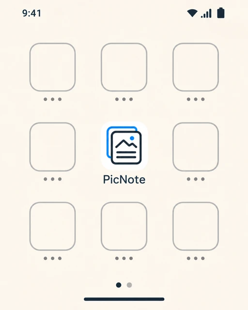

# How to use [Bambootes]?

> This is a short guide to using Bambootes. It shows how screenshots, photos, and your own words can become a clear visual note, with each piece kept in an editable node. Start by finding the Bambootes icon on your phone and opening the app. Later chapters will explain how to add images, edit text, arrange nodes, and export your document. This first example is already saved on your device, so you can explore the node list and document view at your own pace. You can rename, edit, or delete it just like any other document. Everything stays available locally while you learn.

Tap the app icon to open Bambootes.

## TODO
