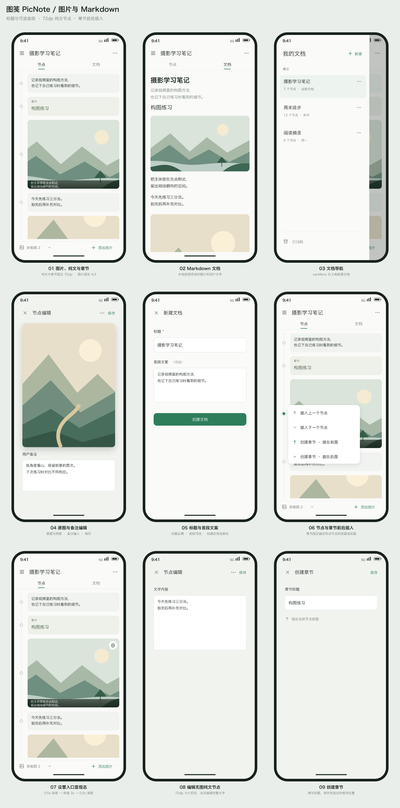

# 图笺 / PicNote 原型图

主界面只有 `节点 / 文档` 两个 Tab。节点页收集、排序图片并编辑备注；文档页只使用 Markdown 显示图片和用户内容。节点编辑遮罩保留带阴影的原图与备注输入框。

新建文档先填写必填标题与可选引言。无图纯文与章节使用固定 72dp 圆角卡，章节按选择固定插在当前节点前面或后面，并在文档中显示为二级标题。

[10-纯文与新建总览.png](10-纯文与新建总览.png) 并排展示节点卡、新建表单与章节插入菜单。



| 图片 | 内容 |
| --- | --- |
| [01-节点页.png](01-节点页.png) | 72dp 纯文与章节卡、4:3 图片与 32dp 备注 |
| [02-文档页.png](02-文档页.png) | 按节点顺序显示原图与用户内容 |
| [03-文档抽屉.png](03-文档抽屉.png) | 右上角新建文档 |
| [04-节点编辑.png](04-节点编辑.png) | 带阴影的原图、用户备注输入框与保存；实现边距以界面设计文档为准 |
| [05-新建文档.png](05-新建文档.png) | 必填标题与可选引言 |
| [06-节点插入菜单.png](06-节点插入菜单.png) | 普通节点与章节固定在前或在后插入 |
| [07-设置显隐.png](07-设置显隐.png) | 设置显现态；0.5s 渐显、停留 3s、0.5s 渐隐 |
| [08-文字节点编辑.png](08-文字节点编辑.png) | 无图节点编辑完整文字 |
| [09-创建章节.png](09-创建章节.png) | 章节标题与选定的插入方向 |

详细交互见 [03-程序界面设计.md](../03-程序界面设计.md)。图片是静态状态示例，PNG 不承载可操作交互。

所有原型和示例图片由 [generate-prototypes.mjs](generate-prototypes.mjs) 的独立矢量源生成，无外部图片依赖。单图 960 × 1940，完整总览 1536 × 3100，纯文与新建总览 1536 × 1110。

在仓库根目录生成（需要 Node.js、npm 和中文字体；示例使用 macOS 的 `Hiragino Sans GB`）：

```bash
npm install --prefix /tmp/picnote-prototype-render --cache /tmp/picnote-prototype-npm-cache --no-audit --no-fund @resvg/resvg-js@2.6.2
PICNOTE_RENDER_MODULE_ROOT=/tmp/picnote-prototype-render/node_modules node PicNote/原型图/generate-prototypes.mjs
```

命令覆盖本目录十一张 PNG，渲染依赖安装在临时目录，不修改仓库的包配置。
